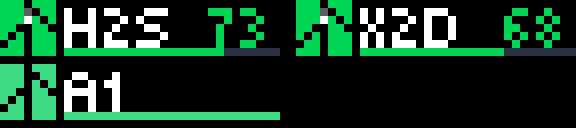
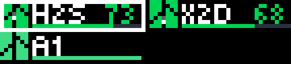

<p align="center">
  
</p>

<h1 align="center">busybar-apps</h1>

<p align="center">
  Apps for the Flipper <b>BUSY Bar</b> that make its 72×16 LED panel earn its desk space,<br>
  and a native macOS menu bar launcher that runs them.
</p>

<p align="center">
  <a href="LICENSE"></a>
  
  
  
</p>

> 한국어 설명은 [아래](#한국어)에 있습니다.

---

## What's inside

| | |
|---|---|
| **`bambu_progress`** | Your Bambu Lab printers, live. Four per screen, dial to pick one, OK for the detail. Finish, pause and error notices in the bar's own visual language. Local MQTT only, no cloud, no developer mode. |
| **`media_remote`** | macOS Now Playing on the bar: YouTube (Chrome), Spotify, Apple Music. Artwork, title, time, a progress bar. OK/START plays and pauses, BACK restarts or goes back, the dial seeks. Apple Music gets synced lyrics. |
| **`steady_clock`** | A clock whose digits never jitter: every digit has a fixed slot. |
| **`launcher/`** | **BUSY Launcher**, a Swift menu bar app. Lists these apps and the community gallery, runs one at a time, bundles its own Python, connects and disconnects the bar. Install the zip and forget about terminals. |

## bambu_progress, up close

<p align="center">
  <br>
  <sub>Turn the dial: a border picks a printer, and goes away by itself after ten seconds.</sub>
</p>

<p align="center">
  <br>
  <sub>Press OK: a ripple, then the detail. Big mark and name on the left, percentage over remaining time on the right.</sub>
</p>

<p align="center">
  <br>
  <sub>A print finishes: a flowing backdrop, a tick that draws itself, then the printer's name. Pause and error get the same treatment in amber and red.</sub>
</p>

Everything that moves is a `.anim` file the bar plays by itself at its own frame rate: the
filament dot running down the mark, the error pulse, the notice backdrops, the enter ripple.
The frames are generated at start-up from a handful of 7×8 bitmaps, so there is no artwork to
maintain and no choppy redrawing over HTTP.

## Quick start

You need Python 3.12+ and a bar on USB (it answers at `http://10.0.4.20`) or on Wi-Fi.

```bash
git clone https://github.com/Keyrnaker/busybar-apps.git && cd busybar-apps
python3 -m venv .venv && source .venv/bin/activate
pip install -r requirements.txt

cp apps/bambu_progress/printers.example.toml apps/bambu_progress/printers.toml
# fill in each printer's IP, serial and LAN access code (Settings › Network on the printer)

python -m apps.bambu_progress.app             # add --host 192.168.1.50 for a bar on Wi-Fi
python -m apps.media_remote.app
python -m apps.steady_clock.app
```

`printers.toml` is git-ignored, so your access codes stay on your machine.

<details>
<summary>No bar yet? Use the emulator.</summary>

```bash
./scripts/setup-emulator.sh       # clones and builds tools/busybar-emulator
./scripts/run-emulator.sh         # http://127.0.0.1:8080
python -m apps.bambu_progress.app --demo --host 127.0.0.1:8080
```
</details>

<details>
<summary>Configuration (<code>printers.toml</code>)</summary>

```toml
[busybar]
host = "10.0.4.20"      # USB default; --host overrides
token = ""              # Wi-Fi access PIN, if you set one

[[printers]]
name = "H2S"            # up to 4 characters on the detail screen, 3 in the grid
ip = "192.168.0.31"
serial = "0938BJ000000000"
access_code = "12345678"

[display]
layout = "grid"         # grid: four per screen | list: two, with longer names
mark = "bambu"          # bambu: the hand-drawn Bambu mark | printer: a neutral extruder
```
</details>

## BUSY Launcher (macOS)

```bash
cd launcher
./scripts/bootstrap.sh            # Xcode command line tools + XcodeGen
./scripts/package.sh              # dist/BUSY-Launcher.zip with a bundled Python
ditto -x -k dist/BUSY-Launcher.zip /Applications
```

Open it, set the bar's address in Settings, pick an app from the menu. There is no login item on
purpose; start it when you want it.

## Notes for people writing their own bar apps

A few things the firmware (1.2.4) does that took a while to learn:

- **Give every element a `z_index`.** The bar sorts an app's elements by it with an unstable sort,
  and elements sent without one get `0, 10, 20…` by position in that request. Elements from
  different requests tie, so the stacking flips on every update.
- **Send only what changed.** Elements persist by id; a re-sent animation restarts from frame 0.
- **An id cannot change type.** Image → animation under the same id is refused. Use separate ids.
- **`.anim` on 1.2.4 is the `bicycle0` container** (the `seq2anim.py` in the firmware repo writes
  `bicycle1`, which this firmware shows as a placeholder). `apps/bambu_progress/anim.py` writes
  BGR888 / BGRA8888 frames with the firmware's RLE; alpha works, so masks and overlays are easy.
- **Fonts**: `tiny` 4 px, `small` 5 px, `bold` 7 px, `extra_large` 10 px. Only `global` has Hangul.
- **Stock assets** reachable through `stock_path` are the ones under `shared/`; the bar's own
  status and transition animations are not.

## Tests

```bash
.venv/bin/pytest -q               # Python apps
launcher/scripts/test.sh          # Swift; quit any running BUSY Launcher first
```

## Licence and trademarks

Code is MIT. This is a personal project with no affiliation to Flipper Devices, BUSY, Bambu Lab,
Google, Spotify or Apple. BUSY Bar, Bambu Lab, YouTube, Spotify and Apple Music are trademarks of
their owners. The pixel rendition of the Bambu mark identifies Bambu printers on the bar and
nothing else; set `mark = "printer"` for a neutral one. No firmware code or assets are included;
the `.anim` container was implemented from the format description in the GPLv2 firmware sources
and the MIT/Apache `busybar-anim` crate.

---

## 한국어

Flipper **BUSY Bar**(72×16 RGB LED 탁상 디스플레이)용 앱 모음과, 그 앱들을 실행하는 macOS 메뉴
막대 런처입니다. 기기에 설치하는 것이 아니라 PC에서 기기의 HTTP API로 화면을 그립니다.

- **bambu_progress**: Bambu Lab 프린터 최대 4대의 진행률과 상태. 다이얼로 고르고 OK로 상세 화면.
  완료·일시정지·오류 알림은 바 기본 화면과 같은 스타일의 애니메이션. 프린터의 로컬 MQTT만 사용합니다.
- **media_remote**: macOS에서 재생 중인 미디어(크롬 유튜브, Spotify, Apple Music)를 바에 보여 주고
  버튼과 다이얼로 조작합니다. Apple Music은 가사도 나옵니다.
- **steady_clock**: 자릿수가 고정되어 흔들리지 않는 시계.
- **launcher/**: 앱을 골라 실행하는 macOS 메뉴 막대 앱. 파이썬이 내장되어 있어 따로 설치할 것이 없습니다.

설치와 실행은 위 Quick start와 같습니다. `printers.toml`은 git에 올라가지 않으니 접근 코드는
안전합니다. 움직이는 효과는 모두 기기가 직접 재생하는 `.anim` 파일이라 끊김이 없습니다.

개인 프로젝트이며 Flipper Devices, BUSY, Bambu Lab과 관계가 없습니다. 코드는 MIT 라이선스입니다.
